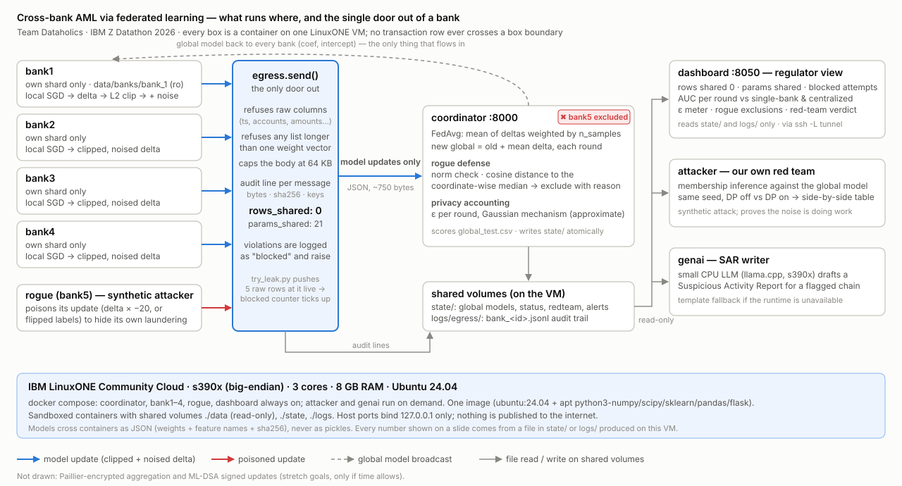

# Dataholics — Cross-Bank Anti-Money-Laundering via Federated Learning

IBM Z Datathon 2026 · Theme: **AI Secured: Innovation Without Exposure** · Team Dataholics, UT Dallas

> What the Dutch banks had to shut down, built so it would have been legal.

Status: under construction during the event (Oct 17–18, 2026). Live board: `STATUS.md`. Every number in this file is
either a `{{PLACEHOLDER}}` or traceable to a file in `state/` or `logs/` produced on the LinuxONE VM.

## 1. Problem

Money launderers split one scheme across several banks because each bank can only see its own transactions. The
obvious fix, pooling raw transactions across banks, keeps failing on legal grounds: the Dutch utility TMNL shut down
in 2024, Singapore's COSMIC only shares after a bank already suspects a customer, and the US 314(b) safe harbour is
barely used. Banks therefore each train a weaker detector on a fragment of the picture.

This project lets banks **train one shared laundering detector without any transaction leaving a bank**, adds
differential privacy so no customer can be recovered from what is shared, detects and excludes a bank that sends
poisoned updates, and then **attacks its own model** to prove the protection works. A small CPU language model
running on the same IBM Z machine writes the suspicious activity report for a flagged cross-bank chain.

## 2. Architecture



Full diagram with the data-flow table: [`docs/architecture.md`](docs/architecture.md). Everything below runs as
sandboxed containers from **one image** on a single IBM LinuxONE VM (s390x, 3 cores, 8 GB), orchestrated by
`docker-compose.yml`.

| Container | Role | Code |
|---|---|---|
| `bank1` … `bank4` | Holds one bank's shard of the dataset. Trains a logistic model locally from the current global weights, clips the weight delta, adds Gaussian noise, and sends **only that delta** through the audited egress function. | `fedaml/bank.py`, `fedaml/dp.py` |
| `rogue` | A fifth bank that poisons its updates (scaled or label-flipped) to hide its own laundering. Synthetic attack. | `fedaml/rogue.py` |
| `coordinator` | Federated averaging weighted by (capped) sample counts; rogue defense by norm check and cosine distance to the coordinate-wise median; approximate ε accounting; writes the global model and `state/status.json` every round. | `fedaml/coordinator.py`, `fedaml/defense.py` |
| egress function | The **only door out of a bank**. Refuses any payload with raw-row keys or oversized lists, logs every message with `rows_shared: 0` and `params_shared: N`. | `fedaml/egress.py`, `scripts/try_leak.py` |
| `dashboard` | The "regulator view": live egress counters, AUC per round against single-bank baselines, privacy-budget meter, rogue exclusions, red-team table, footprint. Port 8050, host-only. | `fedaml/dashboard/` |
| `attacker` | Membership-inference red team (loss-threshold, shadow model, IBM ART black-box) against the global model with DP off vs DP on. | `fedaml/redteam.py` |
| `llm` + `genai` | llama.cpp serving a big-endian GGUF of Qwen2.5-0.5B-Instruct; the SAR writer fills prose only, code inserts every number, id and model hash; template fallback. | `fedaml/llm/`, `fedaml/sar.py`, `fedaml/alerts.py` |
| features / baselines | 20 per-row features that need **no cross-bank statistics**; per-bank LogReg / Random Forest / HistGradientBoosting comparison and the "centralized pooling" model trained on all banks' raw rows (what TMNL did). | `fedaml/features.py`, `fedaml/baselines.py`, `docs/FEATURES.md` |

What leaves a bank each round: one JSON message of about 21 numbers (clipped, noised weight delta), its hash, and
the feature-list hash. What never leaves: transactions, account ids, amounts, labels. The egress log proves it.

## 3. How to run (on the LinuxONE VM)

```bash
# one-time
git clone https://github.com/pedduvedcharan/dataholics-federated-aml.git ~/fedaml && cd ~/fedaml
bash scripts/setup_vm.sh                      # apt python3-* stack, venv, docker compose
# put the Kaggle file at data/raw/HI-Small_Trans.csv (not in the repo), then
.venv/bin/python scripts/partition_data.py    # data/banks/bank_1..5/{train,test}.csv, data/global_test.csv
docker compose build

# federated training: coordinator + 4 banks + rogue + dashboard  (defaults: 10 rounds, DP on, defense on)
docker compose up
DP=off DEFENSE=off docker compose up          # the unprotected run, for comparison

# tools (run on demand)
docker compose run --rm baselines             # per-bank model comparison -> state/baselines.json
docker compose run --rm attacker              # red team table -> state/redteam.json
docker compose run --rm tryleak               # try to send raw rows: blocked and logged
docker compose run --rm llm /app/fetch_model.sh   # one-off: download + big-endian convert the LLM weights
docker compose run --rm alerts                # top-20 flagged chains -> state/alerts.json
ALERT_ID=A01 docker compose run --rm genai    # write state/sar/A01.md with the LLM (template fallback)

# regulator dashboard, from your laptop
ssh -L 8050:localhost:8050 dataholics         # then open http://localhost:8050
```

Nothing is published to the internet: all ports bind `127.0.0.1` on the VM and are reached through an SSH tunnel.
Demo walkthrough: [`submission/DEMO_SCRIPT.md`](submission/DEMO_SCRIPT.md).

## 4. Results

All numbers come from files written on the VM. Placeholders are replaced only from those files.

| Measurement | Value | File of origin |
|---|---|---|
| Best single-bank model, pooled test over banks 2–4 (AUC / AP) | {{BEST_SINGLE_AUC}} / {{BEST_SINGLE_AP}} | `state/baselines.json` |
| Centralized pooling logistic regression, all four banks' raw rows (AUC / AP) | {{CENTRAL_AUC}} / {{CENTRAL_AP}} | `state/baselines.json` |
| Federated global model, DP on, pooled test over banks 2–4 (AUC / AP) | {{AUC_FINAL}} / {{FED_AP}} | `state/status_dpon.json`, `state/baselines.json` |
| Federated global model, DP off (AUC / AP) | {{AUC_FINAL_DPOFF}} / {{FED_AP_DPOFF}} | `state/status_dpoff.json` |
| Bank 1 (code 070), any model, own test set | ≈ 0.5 (not learnable with per-row features, see §6) | `state/baselines.json` |
| Transaction rows shared by all banks, all rounds | 0 | `logs/egress/bank_*.jsonl` |
| Model parameters shared per round per bank | {{PARAMS_SHARED}} | `logs/egress/bank_*.jsonl` |
| Rogue bank excluded in N of R rounds (defense on) | {{ROGUE_EXCLUDED_ROUNDS}} / {{ROUNDS}} | `state/status_rogue_on.json` |
| Global AUC with rogue, defense off / on | {{AUC_DEFENSE_OFF}} / {{AUC_DEFENSE_ON}} | `state/status_rogue_off.json`, `state/status_rogue_on.json` |
| Membership-inference attack accuracy, DP off / on (laundering rows) | {{ATTACK_ACC_OFF}} / {{ATTACK_ACC_ON}} | `state/redteam.json` |
| Privacy budget ε spent (approximate), σ, clip | {{EPSILON}}, {{SIGMA}}, {{CLIP}} | `state/status.json` |
| LLM generation speed on s390x | 27.3 tok/s mean (100 tokens, 3 threads) | `state/llm_runtime.json` |
| Peak RAM, all containers / seconds per round / total runtime | {{PEAK_RSS_MB}} MB / {{SEC_PER_ROUND}} s / {{TOTAL_RUNTIME}} | `state/footprint.json` |

How to read it: the federated model **matches the best single bank on AUC** and **beats centralized pooling on average
precision** (more true laundering per alert), while banks whose own detectors are weak receive the strong model
without sharing a row. The DP-on model pays a small AUC cost for collapsing the membership attack to chance.
Bank 1's laundering (cheque, card and cash from fifteen sender accounts) carries no per-row signal, so every model,
including centralized pooling, scores at chance on it; it trains with the federation and is reported on its own.

## 5. Open-source software and data

All code in `fedaml/` and `scripts/` was written by the team during the event. Libraries used:

| Library | Use | Link |
|---|---|---|
| NumPy, SciPy | numerics | https://numpy.org · https://scipy.org |
| pandas | data partition and feature frames | https://pandas.pydata.org |
| scikit-learn | SGD/L-BFGS logistic regression, Random Forest, HistGradientBoosting, metrics | https://scikit-learn.org |
| Flask | coordinator API and dashboard | https://flask.palletsprojects.com |
| requests | bank → coordinator HTTP | https://requests.readthedocs.io |
| matplotlib | figures for the README/slides | https://matplotlib.org |
| Chart.js | dashboard charts (CDN, in the browser) | https://www.chartjs.org |
| python-paillier (`phe`) | Paillier homomorphic encryption (stretch) | https://github.com/data61/python-paillier |
| dilithium-py | ML-DSA post-quantum signatures on updates (stretch) | https://github.com/GiacomoPope/dilithium-py |
| IBM Adversarial Robustness Toolbox | black-box membership-inference attack | https://github.com/Trusted-AI/adversarial-robustness-toolbox |
| llama.cpp | CPU LLM runtime, built from source for s390x | https://github.com/ggml-org/llama.cpp |
| Qwen2.5-0.5B-Instruct (GGUF, Apache-2.0) | SAR prose generation | https://huggingface.co/Qwen/Qwen2.5-0.5B-Instruct-GGUF |
| Docker Engine + Compose, Ubuntu 24.04 | sandboxed containers on LinuxONE | https://docs.docker.com · https://ubuntu.com |

Dataset: **IBM Transactions for Anti Money Laundering (AML), HI-Small** — synthetic, public, Kaggle:
https://www.kaggle.com/datasets/ealtman2019/ibm-transactions-for-anti-money-laundering-aml (not stored in this repo).
Banks are the `From Bank` field; the four busiest banks become `bank1..bank4`, the fifth busiest is the rogue.

## 6. Claims discipline (what we do and do not claim)

- The data is **synthetic** (IBM AML generator) and the rogue-bank and membership-inference attacks are **synthetic
  attacks we ran against ourselves**. No real customer data anywhere.
- Containers are **sandboxed containers** on a LinuxONE VM. We do not claim IBM Secure Execution or confidential
  computing.
- **ε is approximate.** It comes from a simple Gaussian-mechanism composition bound documented in `fedaml/dp.py`,
  not from a tight accountant.
- Every RAM, time and tokens-per-second figure is **measured on this VM**, never estimated.
- Membership inference here is one attack family (loss-threshold, shadow, ART black-box) against a logistic model.
  Honest limits are in [`docs/REDTEAM.md`](docs/REDTEAM.md); the LLM runtime verdict and fallback rule are in
  [`docs/GENAI.md`](docs/GENAI.md).
- The LLM narrates, the model decides: the SAR's numbers, ids and model hash are inserted by code, and any
  account id the LLM invents triggers the template fallback.

## 7. Repository map

`CLAUDE.md` project context · `docs/CONTRACTS.md` interfaces every module obeys · `docs/FEATURES.md` one line per
feature · `agents/` and `team/` work split · `submission/` demo script, screenshots, video link.
