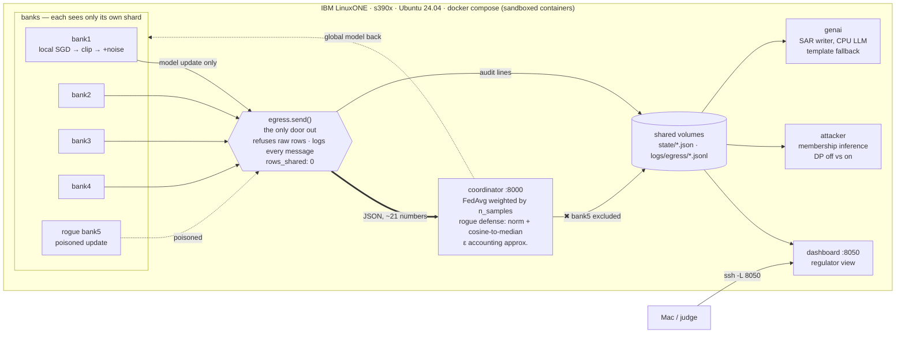

# Architecture

Rendered diagram: `docs/architecture.svg` (hand-drawn SVG, no build step). Same picture as Mermaid, for anyone who prefers to edit text:

What flows where:

| Flow | Content | Never contains |
|---|---|---|
| bank → coordinator | one clipped, noised weight delta per round (JSON, ~750 bytes) | transaction rows, account ids, amounts, labels |
| coordinator → bank | current global `coef`/`intercept` | any bank's data or update |
| everything → dashboard | `state/*.json`, `logs/egress/*.jsonl`, read-only | raw data |
| VM → the world | nothing; ports bind 127.0.0.1, reached through an SSH tunnel | |
